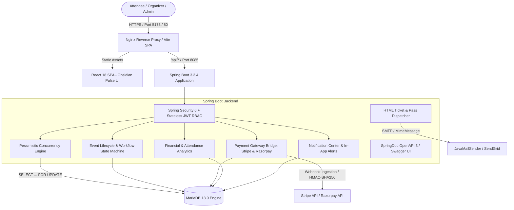

# PulseEvent OS — Enterprise Online Event Management Platform

[](https://openjdk.org/)
[](https://spring.io/projects/spring-boot)
[](https://react.dev/)
[](https://vitejs.dev/)
[](https://mariadb.org/)
[](https://flywaydb.org/)
[](https://www.docker.com/)
[](http://localhost:8085/swagger-ui/index.html)

> **PulseEvent OS** is a full-stack, enterprise-grade Event Management Platform designed for zero-overselling ticketing, strict administrative moderation, high-concurrency door validation, and unified financial analytics.

---

## 🏛️ System Architecture



---

## 🚀 Core Platform Features

### 1. Security & Identity Engine (Phase 1)
- **Stateless JWT Authentication:** HMAC-SHA512 encrypted tokens with 24-hour expiration.
- **Granular RBAC:** Distinct authorization tiers (`ROLE_ADMIN`, `ROLE_ORGANIZER`, `ROLE_ATTENDEE`).
- **Database Migrations:** Managed schema versioning via Flyway (`V1__init_auth_schema.sql`).

### 2. Event Lifecycle Workflow State Machine (Phase 2)
- **Moderation Workflow:** Strict state machine transitions: `DRAFT` $\rightarrow$ `PENDING_APPROVAL` $\rightarrow$ `APPROVED` $\rightarrow$ `PUBLISHED` (with rejection and cancellation handling).
- **Prohibited Self-Approval:** Architectural safeguard preventing organizers from approving their own events, even if granted administrator credentials.
- **Category & Venue Registries:** Rich metadata management with occupancy limits and virtual event tagging.

### 3. Concurrency Protection & Ticketing Hub (Phase 3)
- **Zero-Overselling Guarantee:** Database-level pessimistic write locking (`SELECT ... FOR UPDATE` via `TicketTierRepository.findByIdWithLock`) prevents race conditions during high-volume flash sales.
- **Dynamic QR Code Generation:** Native ZXing 2D barcode generation rendering high-resolution Base64 PNGs embedded into ticket entities.
- **Door Check-In HUD:** Live interactive scanner HUD featuring instant anti-replay protection (prevents double entry) and millisecond validation status badges.

### 4. Financial Analytics Engine & Notification Hub (Phase 4)
- **Real-Time Revenue Analytics:** Computes Gross Platform Merchandise Value (GMV), tier velocity, capacity occupancy, and check-in percentages.
- **RFC 4180 CSV Export:** Direct file streaming of attendee manifests with UTF-8 Byte Order Marks (BOM) for Excel and Google Sheets compatibility.
- **In-App Notification Hub:** Polling-based notification badge with read-state synchronization and automated trigger dispatch on order placement and event moderation.

### 5. Dynamic Promo Codes & Verified Reviews (Phase 5)
- **Promo Code Engine:** Percentage and fixed dollar discounts, usage cap tracking, and order minimum rules.
- **Verified Attendee Reviews:** Post-event star ratings and qualitative reviews with verified attendee badges.

### 6. Waitlist Queue & Automated Refunds (Phase 6)
- **Waitlist Priority Queue:** Ordered queue tracking with automated promotion when seats open up.
- **Self-Service Refunds & Restocking:** Attendee refund submission, admin moderation, and immediate automatic ticket cancellation and inventory restock.

### 7. Enterprise Enhancements
- **Docker Multi-Stage Containerization:** Production-ready `Dockerfile` for backend (JRE 17 Jammy) and frontend (`nginx:alpine` SPA proxy), orchestrated with `docker-compose.yml`.
- **OpenAPI 3 / Interactive Swagger UI:** Self-documenting REST API with JWT Bearer authentication accessible at `http://localhost:8085/swagger-ui/index.html`.
- **Payment Gateway Bridge:** Extensible provider architecture supporting Stripe Checkout sessions, Razorpay orders, and HMAC-SHA256 webhook signature verification.
- **HTML Email Pass Engine:** Generates and dispatches responsive email tickets containing embedded QR codes and event directions.

---

## 🗄️ Database Schema & Flyway Migrations

The database schema is managed via automated Flyway migrations:

| Version | Migration Script | Description |
|---|---|---|
| `V1` | `V1__init_auth_schema.sql` | Users, roles, user-role associations, and unique email constraints |
| `V2` | `V2__init_events_schema.sql` | Categories, venues, and events with workflow state tracking |
| `V3` | `V3__init_tickets_and_orders_schema.sql` | Ticket tiers, orders, order items, and QR tickets with check-in records |
| `V4` | `V4__init_notifications_schema.sql` | In-app notification center table with unread indexes |
| `V5` | `V5__init_payments_schema.sql` | Payment gateway transactions, session IDs, and webhook logs |
| `V6` | `V6__init_phase5_schema.sql` | Promo discount codes, event star reviews, and order discount ledger |
| `V7` | `V7__init_phase6_waitlist_and_refunds.sql` | Waitlist queue positions, offer expiration, and refund requests with admin review |
| `V8` | `V8__init_phase7_agenda_and_speakers.sql` | Speakers, schedule sessions, and attendee bookmarks |
| `V9` | `V9__init_phase8_seat_maps.sql` | Venue seat maps, sections, seats, and 5-min atomic holds |
| `V10` | `V10__init_phase9_dynamic_pricing.sql` | Multi-currency exchange rates and surge pricing rules |
| `V11` | `V11__init_phase12_sponsors_and_leads.sql` | Expo floor sponsors, booth locations, and lead retrieval engine |
| `V12` | `V12__init_phase14_certificates.sql` | Certificates of Attendance & Completion, accredited hours, and public verification |
| `V13` | `V13__init_phase15_live_qa_and_polls.sql` | Live Q&A questions, upvotes, moderation, and real-time audience polling |
| `V14` | `V14__init_phase16_breakout_session_capacity.sql` | Breakout session seat capacity controls, waitlists, and schedule booking |
| `V15` | `V15__init_phase17_networking_and_meetings.sql` | 1-on-1 B2B Networking Hub, attendee matchmaking directory, and scheduled meetings |
| `V16` | `V16__init_phase18_gamification_and_leaderboard.sql` | Gamified attendee engagement, digital scavenger hunt, badges, XP levels, and live leaderboard |

---

## ⚙️ Quick Start Guide

### Prerequisites
- **Java Development Kit (JDK):** Version 17 or higher
- **Node.js:** Version 18 or higher (with npm)
- **Database:** MariaDB 11.4+ or MySQL 8.0+ running on port `3306`

---

### Option A: Local Development Setup

#### 1. Start MariaDB
Ensure MariaDB is listening on `localhost:3306` with database `event_management_db`.

#### 2. Run Backend
```bash
cd backend
./mvnw spring-boot:run
```
*Backend initializes on `http://localhost:8085`.*
- **Swagger UI:** [http://localhost:8085/swagger-ui/index.html](http://localhost:8085/swagger-ui/index.html)
- **OpenAPI Schema:** [http://localhost:8085/v3/api-docs](http://localhost:8085/v3/api-docs)

#### 3. Run Frontend
```bash
cd frontend
npm install
npm run dev
```
*Frontend dev server launches at `http://localhost:5173`.*

---

### Option B: Docker Compose Deployment

To build and run all services in unified Docker containers:

```bash
docker-compose up --build -d
```

| Service | Port Mapping | Description |
|---|---|---|
| **MariaDB** | `3306:3306` | Persistent database with volume mount |
| **Backend** | `8085:8085` | Spring Boot 3 JRE 17 container |
| **Frontend** | `80:80` | Nginx reverse proxy serving React SPA & proxying `/api/*` |

---

## 🧪 Automated Test Suite

PulseEvent OS features a comprehensive regression suite with **22/22 integration tests passing with 0 failures**:

```bash
cd backend
mvn test
```

### Verified Test Suites:
1. `AuthControllerTest` — Registration, JWT login, and role assignment.
2. `EventLifecycleIntegrationTest` — State machine transitions and self-approval ban.
3. `TicketOrderIntegrationTest` — Pessimistic inventory locking and ZXing QR generation.
4. `AnalyticsAndNotificationIntegrationTest` — GMV calculations and notification polling.
5. `PaymentGatewayIntegrationTest` — Stripe sessions, simulated checkout, and webhook signatures.
6. `EmailServiceIntegrationTest` — HTML email rendering with embedded Base64 QR passes.
7. `Phase5IntegrationTest` — Promo discount validations, event review scores, and waitlist entry.
8. `Phase6IntegrationTest` — Waitlist queue promotion, offer claiming, attendee self-service refunds, and admin inventory restock.
9. `Phase7IntegrationTest` — Speaker directory, multi-track sessions, personal schedule bookmarks, and RFC 5545 iCalendar calendar stream.
10. `Phase8IntegrationTest` — Interactive venue seat map, 5-minute atomic holds, collision rejection, and release engine.
11. `Phase9IntegrationTest` — Dynamic surge / early-bird pricing rules and multi-currency converter (USD, EUR, GBP, INR).
12. `Phase10IntegrationTest` — Real-time live turnstile cockpit, door arrival velocity telemetry, and WebSocket/STOMP broadcasting.
13. `Phase11IntegrationTest` — Individual & bulk PDF lanyard badge rendering with 300 DPI QR codes.
14. `Phase12IntegrationTest` — Sponsor booth management, multi-tier exhibitions, and exhibitor lead capture with CSV export.
15. `Phase13IntegrationTest` — Gemini AI marketing copy generation with heuristic fallback.
16. `Phase14IntegrationTest` — Accredited certificate issuance, public QR verification, and high-res PDF generation.
17. `Phase15IntegrationTest` — Live interactive Q&A upvoting, moderation, and multi-choice live poll voting.
18. `Phase16IntegrationTest` — Breakout room seat reservations, schedule conflict resolver, atomic capacity locks, waitlist queue auto-promotion, and multi-track room heatmaps.
19. `Phase17IntegrationTest` — Attendee 1-on-1 networking profile matchmaking, directory search with interest filtering, schedule conflict resolver, dynamic table allocation, meeting invitations, accept/decline state machine, and cancellations.

---

## 🔌 API Endpoint Catalog

### Authentication (`/api/auth`)
- `POST /api/auth/register` — Register a new account (`ROLE_ATTENDEE` or `ROLE_ORGANIZER`).
- `POST /api/auth/login` — Authenticate and obtain JWT Bearer token.
- `GET /api/auth/me` — Retrieve current authenticated user profile.

### Events (`/api/events`)
- `GET /api/events` — Public discovery with search, category, and city filters.
- `POST /api/events/draft` — Create a new event draft (Organizer).
- `POST /api/events/{id}/submit` — Submit draft for admin moderation.
- `POST /api/events/{id}/publish` — Publish approved event to catalog.
- `POST /api/events/{id}/cancel` — Cancel event with audit status.

### Ticket Tiers & Orders (`/api/orders`, `/api/tickets`)
- `GET /api/events/{id}/tiers` — Fetch active tiers and real-time inventory.
- `POST /api/orders` — Atomically purchase tickets with pessimistic write lock and promo codes.
- `GET /api/orders/my-orders` — List past orders for attendee.
- `GET /api/tickets/my-tickets` — Retrieve personal digital passes with QR codes.
- `POST /api/tickets/check-in` — Validate QR code at venue entrance with anti-replay detection and live WebSocket broadcast.
- `GET /api/tickets/event/{id}/door-stats` — Live turnstile telemetry: total issued, checked-in, pending, percentage, and 15-min arrival velocity.

### Phase 7: Conference Agenda & Speakers (`/api/events/{id}`)
- `GET /api/events/{id}/speakers` — Query keynote and panel speakers.
- `POST /api/events/{id}/speakers` — Register speaker bio, avatar, and social links.
- `GET /api/events/{id}/sessions` — Retrieve chronological track schedule.
- `POST /api/events/{id}/sessions` — Schedule multi-track sessions with room allocation.
- `GET /api/schedule/my-bookmarks` — Query attendee's bookmarked personal agenda.
- `POST /api/schedule/bookmark/{sessionId}` — Toggle session bookmark.
- `GET /api/events/{id}/calendar.ics` — Export full agenda as RFC 5545 iCalendar stream.

### Phase 8: Venue Seat Maps & Reserved Seating (`/api/events/{id}/seat-map`, `/api/seats`)
- `GET /api/events/{id}/seat-map` — Visual venue seating layout by section and row.
- `POST /api/events/{id}/seat-map/init` — Initialize venue grid sections and seats.
- `POST /api/seats/{id}/hold` — Acquire 5-minute atomic hold lock on designated seat.
- `POST /api/seats/{id}/release` — Release held seat back to public inventory.

### Phase 9: Dynamic Surge Pricing & Multi-Currency (`/api/pricing`)
- `GET /api/pricing/currencies` — List supported currencies (USD, EUR, GBP, INR) and live exchange rates.
- `POST /api/pricing/convert` — Real-time currency converter for arbitrary amounts.
- `GET /api/pricing/tiers/{tierId}/quote?currency=EUR` — Real-time dynamic price quote applying surge and exchange rates.
- `POST /api/pricing/rules` — Configure inventory threshold or time-decay pricing multipliers.

### Phase 10: WebSocket & Live Turnstile Cockpit (`/ws-eventflow`)
- `STOMP /ws-eventflow` — SockJS / WebSocket endpoint with broker `/topic`.
- `SUB /topic/events/{id}/checkins` — Event-specific live attendee entry stream.
- `SUB /topic/turnstile/live` — Global turnstile broadcast for venue gatekeepers.

### Phase 11: Conference Attendee PDF Badges & Lanyards (`/api/tickets`, `/api/events`)
- `GET /api/tickets/{ticketCode}/badge.pdf` — Stream personalized 4"x6" lanyard conference badge PDF with high-res QR code and color-coded tier headers.
- `GET /api/events/{eventId}/badges.pdf` — Bulk kiosk print export of all confirmed event attendee passes as a paginated PDF.

### Phase 12: Sponsor & Exhibitor Booth Floor with Lead Retrieval (`/api/sponsors`, `/api/events`)
- `GET /api/events/{eventId}/sponsors` — Public conference sponsor directory organized by tier (Title, Platinum, Gold, Silver).
- `POST /api/events/{eventId}/sponsors` — Register new exhibition booth, tier level, and company profile.
- `POST /api/sponsors/{id}/leads/scan` — Exhibitor digital lead capture scanning attendee ticket code with 1-5 star rating and qualification notes.
- `GET /api/sponsors/{id}/leads` — Query captured exhibitor lead roster.
- `GET /api/sponsors/{id}/leads/export.csv` — Download RFC 4180 CSV spreadsheet of captured booth leads.

### Phase 13: AI Marketing & Copywriter Assistant (`/api/ai`)
- `POST /api/ai/generate-event-copy` — Synthesize high-converting headline variations, SEO URL slugs, short hooks, multi-section agendas, email marketing blasts, and social media posts powered by Gemini (with deterministic heuristic fallback).

### Phase 14: Certificate of Attendance & Completion Engine (`/api/certificates`, `/api/events`)
- `POST /api/events/{eventId}/certificates/claim` — Claim personalized Certificate of Attendance / Completion with accredited CPD hours.
- `GET /api/certificates/{certificateCode}/pdf` — Download official landscape A4 certificate PDF with gold borders, committee sign-off, and embedded verification QR code.
- `GET /api/certificates/verify/{certificateCode}` — Public endpoint returning cryptographic authenticity status and event attestation metadata.
- `GET /api/certificates/my-certificates` — Retrieve attendee's claimed credential portfolio.
- `GET /api/events/{eventId}/certificates` — Organizer/Admin query of all issued credentials for an event.

### Phase 15: Live Audience Interactive Q&A and Polls Engine (`/api/events`, `/api/qa`, `/api/polls`, `/topic/events`)
- `GET /api/events/{eventId}/qa` — Real-time Q&A stream sorted with pinned questions first, then by community upvotes descending.
- `POST /api/events/{eventId}/qa` — Attendee question submission with optional anonymous pseudonym masking and WebSocket broadcast.
- `POST /api/qa/{questionId}/upvote` — Atomic toggle upvoting with WebSocket broadcast to `/topic/events/{id}/qa`.
- `PUT /api/qa/{questionId}/status` — Organizer stage moderation (`OPEN`, `PINNED`, `ANSWERED`, `DISMISSED`).
- `GET /api/events/{eventId}/polls` — Live audience polls with aggregated option vote tallies, percentage distributions, and user vote status.
- `POST /api/events/{eventId}/polls` — Organizer poll creator with up to 6 custom multi-choice options.
- `POST /api/polls/{pollId}/vote` — Attendee single-vote casting with dynamic recalculation and WebSocket broadcast to `/topic/events/{id}/polls`.
- `PUT /api/polls/{pollId}/status` — Organizer poll lifecycle controller (`DRAFT`, `ACTIVE`, `CLOSED`).

### Phase 16: Multi-Track Breakout Session Room Booking, RSVP Engine & Time Conflict Resolver (`/api/sessions`, `/api/events`)
- `POST /api/sessions/{sessionId}/rsvp` — Attendee breakout seat reservation with ticket verification, atomic room seating capacity limits, overlap conflict detection, and waitlist overflow queuing.
- `DELETE /api/sessions/{sessionId}/rsvp` — Attendee seat reservation cancellation with automatic promotion of next waitlisted attendee and notification dispatch.
- `GET /api/events/{eventId}/my-rsvps` — Query personal timetable of confirmed breakout reservations and waitlist positions.
- `GET /api/sessions/{sessionId}/capacity` — Real-time room seating capacity status: total seats, reserved count, available seats, and occupancy percentage.
- `GET /api/events/{eventId}/sessions/heatmap` — Multi-track room occupancy heatmap aggregating session room loads, peak occupancies, and status indicators (`COMFORTABLE`, `FILLING_FAST`, `FULL_WAITLIST`).

### Phase 17: Attendee 1-on-1 B2B Networking Hub & Meeting Scheduler (`/api/events`, `/api/networking`)
- `GET /api/events/{eventId}/networking/profile` — Retrieve current attendee's networking bio, skills, company, goals, and availability status.
- `POST /api/events/{eventId}/networking/profile` — Create or update attendee's professional headline, company, job title, interest tags, and networking availability.
- `GET /api/events/{eventId}/networking/attendees` — Search and filter attendee matchmaking directory with keyword query and interest tags.
- `POST /api/events/{eventId}/networking/meetings` — Request a 1-on-1 meeting with automatic table allocation (Tables #1–50) and dual-schedule conflict checks against overlapping meetings and confirmed breakout session RSVPs.
- `GET /api/events/{eventId}/networking/meetings` — Query personal timetable of incoming, outgoing, and confirmed 1-on-1 meetings.
- `PUT /api/networking/meetings/{meetingId}/respond?accept=true|false` — Accept or decline an incoming 1-on-1 meeting invitation with in-app notification dispatch.
- `DELETE /api/networking/meetings/{meetingId}` — Cancel a scheduled 1-on-1 meeting and release the allocated table back to the meeting zone inventory.

### Promo Codes & Reviews (`/api/promo-codes`, `/api/events/{id}/reviews`)
- `POST /api/promo-codes/validate` — Validate discount code and compute reduced cart totals.
- `GET /api/promo-codes` — List active promotional discounts.
- `POST /api/promo-codes` — Create custom discount codes (Organizer/Admin).
- `GET /api/events/{id}/reviews` — Fetch attendee ratings and qualitative event reviews.
- `POST /api/events/{id}/reviews` — Submit verified attendee review and star score.

### Waitlist Queue (`/api/waitlist`)
- `POST /api/waitlist/join` — Join priority waitlist queue for sold-out tiers.
- `GET /api/waitlist/my-entries` — Query user's active waitlist positions.
- `DELETE /api/waitlist/{id}` — Opt-out or leave waitlist queue.
- `POST /api/waitlist/{id}/claim` — Claim promoted waitlist ticket offer before expiration.

### Refunds & Cancellations (`/api/refunds`)
- `POST /api/refunds/request` — Attendee self-service refund submission.
- `GET /api/refunds/my-requests` — Attendee query of submitted refund tickets.
- `GET /api/refunds` — List platform refund queue (Organizer/Admin).
- `POST /api/refunds/{id}/review` — Approve or reject refund with immediate automatic ticket invalidation and tier inventory restocking.

### Payments (`/api/payments`)
- `POST /api/payments/checkout-session` — Initialize Stripe or Razorpay checkout session.
- `GET /api/payments/{reference}` — Query live transaction status.
- `POST /api/payments/confirm/{reference}` — Confirm simulated sandbox payment.
- `POST /api/payments/webhook/{provider}` — Ingest signed webhook events from payment gateway.

### Financial Analytics (`/api/analytics`)
- `GET /api/analytics/organizer` — Aggregated revenue and ticket sales for organizer.
- `GET /api/analytics/events/{id}` — In-depth breakdown for a specific event.
- `GET /api/analytics/admin` — Platform-wide metrics, GMV, and top-performing events.
- `GET /api/events/{id}/export/attendees` — Stream RFC 4180 attendee CSV file.

### Notification Hub (`/api/notifications`)
- `GET /api/notifications` — Retrieve user notifications.
- `GET /api/notifications/unread-count` — Real-time unread alert count.
- `PUT /api/notifications/{id}/read` — Mark notification as acknowledged.
- `PUT /api/notifications/read-all` — Mark all alerts as acknowledged.

### 1-on-1 B2B Networking Hub (`/api/events/{id}/networking`, `/api/networking`)
- `GET /api/events/{id}/networking/profile` — Fetch attendee's networking matchmaking profile.
- `POST /api/events/{id}/networking/profile` — Create or update networking profile (headline, bio, tags, LinkedIn, matchmaking toggle).
- `GET /api/events/{id}/networking/attendees` — Search opted-in attendees by topic, company, or query.
- `POST /api/events/{id}/networking/meetings` — Request scheduled 1-on-1 table meeting.
- `GET /api/events/{id}/networking/meetings` — List attendee's scheduled and requested meetings.
- `PUT /api/networking/meetings/{id}/respond?accept=true` — Accept or decline meeting invitation.
- `DELETE /api/networking/meetings/{id}` — Cancel scheduled meeting and release networking table.

### Gamification, Digital Scavenger Hunt & Leaderboards (`/api/events/{id}/gamification`)
- `GET /api/events/{id}/gamification/profile` — Query attendee's total XP, tier (`NOVICE`, `BRONZE`, `SILVER`, `GOLD`, `PLATINUM`), rank position, unlocked badges, recent activity timeline, and VIP Swag Pass status.
- `GET /api/events/{id}/gamification/leaderboard?limit=20` — Public real-time event leaderboard returning ranked attendees, total XP, tier status, and badge counts.
- `POST /api/events/{id}/gamification/scan-booth/{sponsorId}` — Scan a sponsor expo booth QR code to earn +75 XP and unlock the "Expo Explorer" badge.
- `POST /api/events/{id}/gamification/session-checkin/{sessionId}` — Check in to a breakout session to earn +150 XP and unlock the "Knowledge Seeker" badge.
- `POST /api/events/{id}/gamification/award-xp` — Award XP points for turnstile check-ins, live Q&A questions, poll votes, or networking meetings with idempotency protection.
- `POST /api/events/{id}/gamification/claim-swag` — Claim physical VIP convention swag bag with unlocked pass code (`SWAG-XXXXXXXX`) upon reaching Gold or Platinum tier.

---

## 🎨 Design System: "Obsidian Pulse"

The frontend interface utilizes a modern, cohesive design language crafted with Vanilla Scoped CSS:
- **Palette Tokens:** Deep space background (`#090D16`), card surface layer (`#111827`), primary indigo gradient (`#6366F1` $\rightarrow$ `#4F46E5`), and emerald accents (`#10B981`).
- **Interactive HUDs:** Glassmorphic check-in cockpit with visual audio-style cues and real-time inventory meters.
- **Accessibility:** High contrast text tokens, accessible button hit areas, and semantic HTML5 landmarks.

---

## 📄 License
This project is open-source and available under the **MIT License**.
